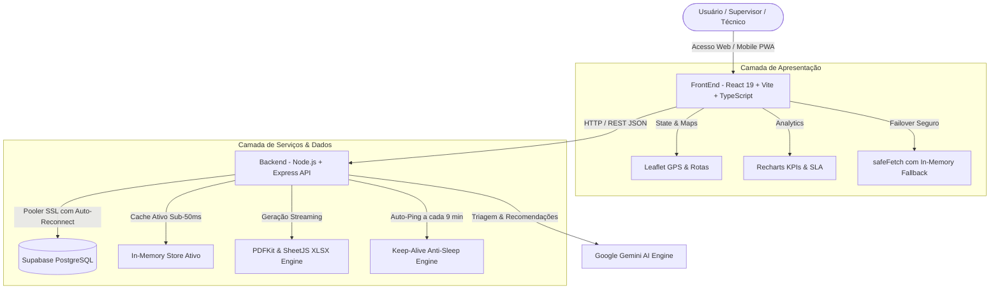

<div align="center">

# 🛗 OTIS SmartFlow IA
### Plataforma Inteligente de Gestão Operacional, Despacho Preditivo e Telemetria IoT para Frotas de Elevadores

[](https://react.dev/)
[](https://www.typescriptlang.org/)
[](https://nodejs.org/)
[](https://expressjs.com/)
[](https://supabase.com/)
[](https://tailwindcss.com/)
[](https://web.dev/progressive-web-apps/)
[](#)

<p align="center">
  <b>Solução de ponta a ponta desenvolvida para otimizar o tempo de resposta a emergências (passageiro retido), automatizar a roteirização de técnicos em campo, prever falhas antes de sua ocorrência via IoT e maximizar o cumprimento de SLA e margem financeira dos contratos da OTIS.</b>
</p>

[Visão Geral](#-visão-geral) •
[Arquitetura](#-arquitetura-do-sistema) •
[Módulos Principais](#-módulos-da-plataforma) •
[Dicionário de APIs](#-dicionário-de-apis-restful) •
[Execução Local](#-como-executar-localmente) •
[Deploy](#-deploy-em-produção) •
[Manual em PDF](#-documentação-técnica-completa-em-pdf)

---

</div>

## 📌 Visão Geral

O **OTIS SmartFlow IA** é um ecossistema completo de gestão técnica e preditiva criado para atender às demandas de alta criticidade da **OTIS Elevadores**. A plataforma combina:

- **Despacho Dinâmico em Tempo Real:** Priorização algorítmica de ordens de serviço. Em chamados com passageiro preso, ativa automaticamente o protocolo de emergência com teto de 45 minutos de SLA e roteirização do técnico especialista mais próximo.
- **Telemetria Preditiva IoT:** Monitoramento contínuo de aceleração, vibração nos cabos de tração, temperatura do motor de tração e desgaste dos operadores de porta.
- **Inteligência Artificial (Gemini + Motor Heurístico):** Análise preditiva de probabilidade de quebra (MTBF / RUL) e sugestão imediata de peças de reposição e ferramentas.
- **Rastreamento Geoespacial (Leaflet):** Mapa ao vivo com posições de técnicos, veículos de suporte e elevadores cadastrados.
- **Compliance Trabalhista & Ponto Eletrônico:** Registro digital de ponto com validação por cerca virtual (Geofence) e cálculo automatizado de bônus por SLA atingido.
- **Gestão Financeira & DRE de Contratos:** Monitoramento de margem de contribuição, custos de peças vs mão de obra e rentabilidade por cliente.

---

## 🏗️ Arquitetura do Sistema

O projeto é estruturado em duas camadas principais totalmente desacopladas e integradas via APIs RESTful:



### 🛡️ Princípios de Resiliência:
1. **Dual-Layer Data Store:** Todas as mutações são gravadas de forma assíncrona no PostgreSQL do **Supabase**, enquanto um *cache em memória* ativo garante que a API continue respondendo em menos de 50ms mesmo sob oscilações do banco de dados na nuvem.
2. **Keep-Alive Inteligente:** Rotina com auto-ping a cada 9 minutos no backend que impede o congelamento (*cold start*) da instância em ambientes como o Render.
3. **Resolução Dinâmica de URLs (`apiService.ts`):** O frontend detecta automaticamente se está em ambiente local (`localhost:8080`), em produção (`/api/v1` via proxy reverso do Vercel) ou via URL personalizada configurada diretamente pelo usuário no painel de configurações.

---

## ⚡ Módulos da Plataforma

| Módulo | Descrição Funcional |
| :--- | :--- |
| **🤖 SmartFlow Intelligence** | Copiloto com IA que processa linguagem natural, avalia parâmetros de telemetria e sugere decisões de despacho. |
| **🚨 Despacho de Chamados (Calls)** | Gestão completa de ordens de serviço (OS) em formato Kanban ou lista, com triagem inteligente e cálculo de SLA. |
| **🗺️ Centro de Operações & Mapas** | Rastreamento em tempo real com Leaflet, exibição de veículos, técnicos em trânsito e rotas até o local do chamado. |
| **⚙️ Parque de Equipamentos (IoT)** | Monitoramento de elevadores e escadas rolantes (modelo Gen2, SkyRise), alertas de temperatura e vibração. |
| **🔮 Análise Preditiva & Futuro IoT** | Estimativa de vida útil de componentes críticos (RUL) e detecção de padrões anômalos de desgaste. |
| **📦 Almoxarifado Preditivo (Peças)** | Controle de estoque de peças críticas (ex.: placas AT120, sensores magnéticos) e requisições de campo. |
| **👥 Recursos Humanos & Ponto** | Ponto eletrônico digital para técnicos com validação de raio geográfico (Geofence) e aprovação de bônus por produtividade. |
| **💼 Contratos & DRE Financeiro** | Visão financeira da carteira: receita mensal, despesas acumuladas e margem operacional líquida. |
| **⚖️ Auditoria de Decisões** | Comparativo analítico entre as recomendações da Inteligência Artificial e as decisões manuais do supervisor. |
| **📊 Central de Relatórios Nativos** | Download em tempo real de relatórios executivos em **PDF** formatado e planilhas em **Excel (.xlsx)**. |
| **📱 PWA Offline-First** | Suporte a instalação como aplicativo na tela de início (iOS/Android/Desktop) com Service Worker para cache da casca do app. |

---

## 🛠️ Tecnologias Utilizadas

### Frontend
- **Framework:** [React 19](https://react.dev/) com [TypeScript](https://www.typescriptlang.org/)
- **Build Tool:** [Vite](https://vitejs.dev/)
- **Estilização:** [Tailwind CSS v4](https://tailwindcss.com/)
- **Mapas Interativos:** [Leaflet](https://leafletjs.com/) & React Leaflet
- **Gráficos & Dashboards:** [Recharts](https://recharts.org/)
- **Iconografia & Microinterações:** [Lucide React](https://lucide.dev/) & [Motion](https://motion.dev/)
- **Deploy:** [Vercel](https://vercel.com/) com proxy reverso e SPA rewrites

### Backend
- **Runtime:** [Node.js](https://nodejs.org/) (ES Modules)
- **Framework Web:** [Express.js](https://expressjs.com/)
- **Banco de Dados:** [PostgreSQL](https://www.postgresql.org/) gerenciado via [Supabase](https://supabase.com/) com conexão SSL
- **Relatórios & Dossiês:** [PDFKit](https://pdfkit.org/) (PDF nativo) e [SheetJS (XLSX)](https://sheetjs.com/) (Planilhas Excel)
- **Deploy:** [Render](https://render.com/) com monitoramento preventivo Keep-Alive

---

## 🔌 Dicionário de APIs RESTful

A API do backend opera com prefixo `/api/v1` e disponibiliza os seguintes serviços:

### 1. Infraestrutura & Saúde
- `GET /` — Informações sobre a versão do motor da API e endpoints disponíveis.
- `GET /health` e `GET /api/v1/health` — Endpoint de liveness probe para checagem de uptime.

### 2. Chamados & Ordens de Serviço (`/api/v1/calls`)
- `GET /api/v1/calls` — Retorna chamados filtrados por status (`ABERTO`, `EM_ANDAMENTO`, `CONCLUIDO`) e prioridade (`EMERGENCIA`, `ALTA`, `NORMAL`).
- `GET /api/v1/calls/:id` — Detalhes completos do chamado e timeline de eventos.
- `POST /api/v1/calls` — Abertura de chamado técnico com cálculo automático de SLA.
- `PUT /api/v1/calls/:id` — Sincronização de chamado com proteção de concorrência (*Last-Write-Wins*).
- `PATCH /api/v1/calls/:id/status` — Atualiza o status do chamado.
- `POST /api/v1/calls/:id/assign` — Atribui um técnico de campo à ordem de serviço.

### 3. Equipamentos & IoT (`/api/v1/equipments`)
- `GET /api/v1/equipments` — Lista de elevadores com dados de telemetria, vibração e cidade.
- `GET /api/v1/equipments/risk/:riskLevel` — Filtra equipamentos por risco (`CRITICO`, `ALTO`, `MEDIO`, `BAIXO`).
- `GET /api/v1/equipments/:id` — Telemetria detalhada de um elevador específico.
- `POST /api/v1/equipments` — Cadastra um novo equipamento na frota.
- `PATCH /api/v1/equipments/:id/status` — Altera status operacional (ex: `NORMAL`, `MANUTENCAO`).

### 4. Técnicos & Geolocalização (`/api/v1/technicians`)
- `GET /api/v1/technicians` — Lista técnicos de campo com coordenadas de GPS `{lat, lng}`, veículo alocado e status.
- `GET /api/v1/technicians/:id` — Perfil e localização do técnico.
- `PATCH /api/v1/technicians/:id/status` — Atualiza status (`DISPONIVEL`, `EM_ATENDIMENTO`, etc.).

### 5. Motor de Inteligência Artificial (`/api/v1/ai`)
- `POST /api/v1/ai/query` — Processa consultas em linguagem natural e devolve métricas e ações recomendadas.
- `POST /api/v1/ai/analyze-call` — Triagem de chamados: identifica prioridade, técnico ideal, peças e ferramentas recomendadas.

### 6. Almoxarifado & Peças (`/api/v1/parts`)
- `GET /api/v1/parts` — Catálogo completo de componentes e níveis de estoque.
- `GET /api/v1/parts/abnormal` — Lista peças com desvio de consumo ou estoque abaixo do mínimo de segurança.
- `GET /api/v1/parts/requests` — Lista requisições de peças feitas pelos técnicos em campo.
- `POST /api/v1/parts/requests` — Solicita envio urgente de componente para o local do atendimento.
- `PATCH /api/v1/parts/requests/:id/status` — Aprova ou rejeita requisição de peças.

### 7. Recursos Humanos & Ponto Digital (`/api/v1/employees`)
- `GET /api/v1/employees` — Lista de colaboradores, especialidades, turnos e salários.
- `GET /api/v1/employees/punches` — Histórico de batidas de ponto eletrônico.
- `POST /api/v1/employees/punches` — Marcação de ponto validada por coordenadas e cerca geográfica (Geofence).
- `PATCH /api/v1/employees/:id/bonus` — Aprovação de bônus por cumprimento de SLA.

### 8. Gestão de Contratos, Alertas & Métricas
- `GET /api/v1/contracts` — Carteira de contratos com análise de margem e DRE.
- `GET /api/v1/campaigns` — Campanhas ativas de manutenção preventiva por polo.
- `GET /api/v1/alerts` — Alertas de sensores IoT (vibração anômala, temperatura excessiva).
- `PATCH /api/v1/alerts/:id/resolve` — Marcação de alerta como resolvido com justificativa do operador.
- `GET /api/v1/dashboard/metrics` — Agregação consolidada dos KPIs executivos da frota nacional.

### 9. Central de Relatórios (`/api/v1/reports`)
- `GET /api/v1/reports/types` — Catálogo dos relatórios executivos homologados.
- `GET /api/v1/reports/download/:reportType` — Download do arquivo binário em **PDF** ou **Excel (.xlsx)**.

---

## 📦 Como Executar Localmente

### Pré-requisitos
- [Node.js](https://nodejs.org/) v18.0.0 ou superior instalado
- Gerenciador de pacotes `npm`

### 1. Clonar o Repositório
```bash
git clone https://github.com/SEU_USUARIO/otissmartflow.git
cd otissmartflow
```

### 2. Instalar as Dependências
Instale as dependências da raiz, do Frontend e do Backend:
```bash
npm install
npm --prefix FrontEnd install
npm --prefix Backend install
```

### 3. Configurar as Variáveis de Ambiente
Copie os modelos de exemplo nas respectivas pastas:

**Para o Backend:**
```bash
cp Backend/.env.example Backend/.env
```
*(Opcional: configure a string `DATABASE_URL` do seu PostgreSQL Supabase. Caso não preencha, o sistema utiliza automaticamente o store em memória de alta performance com dados mockados).*

**Para o Frontend:**
```bash
cp FrontEnd/.env.example FrontEnd/.env
```

### 4. Executar os Projetos

Você pode iniciar o Frontend e o Backend individualmente ou em conjunto:

**Iniciando o Frontend (porta 3000):**
```bash
npm run dev
```

**Iniciando o Backend (porta 8080):**
```bash
npm run backend:dev
```

Acesse a aplicação no navegador em:
👉 **[http://localhost:3000](http://localhost:3000)**

Para testar a API diretamente:
👉 **[http://localhost:8080](http://localhost:8080)** ou **[http://localhost:8080/api/v1/health](http://localhost:8080/api/v1/health)**

---

## ⚙️ Variáveis de Ambiente

### Backend (`Backend/.env`)
| Variável | Padrão | Descrição |
| :--- | :--- | :--- |
| `PORT` | `8080` | Porta onde a API Express escuta as requisições |
| `DATABASE_URL` | *(Supabase URL)* | String de conexão PostgreSQL com SSL |
| `CORS_ORIGIN` | `*` | Origens autorizadas para consumo da API |
| `RENDER_EXTERNAL_URL` | `https://otissmartflow-1.onrender.com` | URL do ping automático para o Keep-Alive |

### Frontend (`FrontEnd/.env`)
| Variável | Padrão | Descrição |
| :--- | :--- | :--- |
| `VITE_API_URL` | `http://localhost:8080/api/v1` | URL base do gateway da API REST |
| `VITE_REPORTS_URL` | `http://localhost:8080/reports` | URL do serviço de download de relatórios |
| `GEMINI_API_KEY` | `""` | Chave de API opcional do Google AI Studio para o Copilot |

---

## 📱 Instalação como Aplicativo (PWA)

O OTIS SmartFlow inclui manifesto web oficial (`public/manifest.webmanifest`) e Service Worker (`public/sw.js`):

- **No Celular (iOS - Safari):** Toque no botão de compartilhamento e selecione **"Adicionar à Tela de Início"**.
- **No Celular (Android - Chrome):** Toque no banner inferior ou no menu de 3 pontos e clique em **"Instalar Aplicativo"**.
- **No Computador (Chrome / Edge):** Clique no ícone de instalação na barra de endereço do navegador.

---

## 🚀 Deploy em Produção

O projeto foi projetado com arquitetura multi-cloud resiliente:

1. **Frontend na Vercel:** O arquivo [`vercel.json`](vercel.json) já está configurado com regras de rewrite, permitindo que requisições para `/api/v1/*` sejam encaminhadas de forma transparente para o backend, eliminando problemas de CORS ou requisições HTTP mistas (Mixed Content).
2. **Backend no Render:** Executa o container Node.js com conexão SSL direta ao banco de dados e rotina de Keep-Alive preventivo.
3. **Banco de Dados no Supabase:** PostgreSQL gerenciado na nuvem com pooling de conexões PgBouncer.

---

## 📄 Documentação Técnica Completa em PDF

Um dossiê detalhado em PDF com a documentação de arquitetura, topologia, esquemas de dados e especificação completa de cada endpoint foi gerado e está disponível no repositório:

- 📥 **Baixar Manual Técnico:** [`OTIS_SmartFlow_Documentacao_Tecnica.pdf`](OTIS_SmartFlow_Documentacao_Tecnica.pdf)
- ⚙️ **Script de Geração:** Para recompilar o PDF a qualquer momento com novas alterações, execute:
  ```bash
  npm run generate-docs
  ```

---

## 👥 Contribuição & Equipe

Projeto desenvolvido para modernização da operação de campo e atendimento a incidentes críticos da **OTIS Elevator Company**.

1. Faça o Fork do projeto
2. Crie uma branch para sua funcionalidade (`git checkout -b feat/nova-funcionalidade`)
3. Faça o commit de suas alterações (`git commit -m 'feat: Adiciona nova funcionalidade'`)
4. Faça o push para a branch (`git push origin feat/nova-funcionalidade`)
5. Abra um Pull Request

---

<div align="center">
  <sub>OTIS SmartFlow IA © 2026 • Tecnologia a serviço da mobilidade urbana segura e contínua.</sub>
</div>
